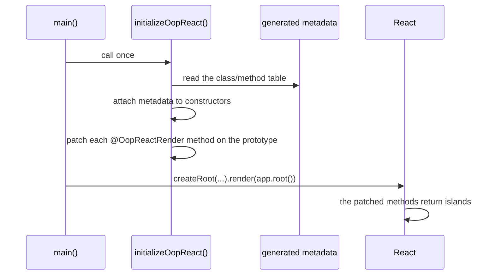

# Getting started

A consumer module needs four things: the library, the KSP processor, the generated call, and `@JsName`
on every annotated member.

## Dependencies

```kotlin
plugins {
    kotlin("multiplatform")
    id("com.google.devtools.ksp")
}

kotlin {
    js {
        useEsModules()
        browser()
    }
}

dependencies {
    implementation("io.github.shijianjs:ktjs-oop-react:<version>")
    add("kspJs", "io.github.shijianjs:ktjs-oop-react-ksp:<version>")
}
```

`kspJs`, not `ksp`: the processor reads the JS compilation's sources and writes the generated file into
the same compilation. The library is a Kotlin/JS re-implementation, not a wrapper of an npm package, so
no npm dependency is involved.

## The four annotations

| Annotation | Goes on | Meaning |
| --- | --- | --- |
| `@OopReactState` | a class | the instance is observable; its fields are tracked |
| `@OopReactRender` | a member function returning `ReactNode` | the method becomes a React island |
| `@OopReactAction` | a member function | the call is a MobX action (state changes inside it are batched) |
| `@OopReactIgnore` | a member | exclude it explicitly, so the processor does not report it |

The processor generates exactly one function per module:

```kotlin
package io.github.shijianjs.ktjs.oopreact.generated

fun initializeOopReact() { /* oopReactMeta(...) per annotated class */ }
```

Call it **once**, before the first render:

```kotlin
fun main() {
    initializeOopReact()
    createRoot(document.getElementById("root")!!).render(App().root())
}
```



Without that call the annotated classes are ordinary classes: no subscription, no islands, no error
boundary — and nothing throws to tell you so.

## `@JsName` is mandatory

Kotlin/JS compiles a member `view()` into `view_<hash>_k$`, and the hash cannot be derived from the
source. The runtime reaches members by JavaScript name, so every annotated member declares one:

```kotlin
@OopReactRender
@JsName("view")
fun view(): ReactNode = ...
```

The processor fails the build when it is missing, and tells you which name to add. This is the single
most common first error.

## The DSL

`jsx { }` is the body of a render method: it is a React fragment, so it adds no wrapper element, and
inside it the kotlin-wrappers HTML DSL is available.

```kotlin
@OopReactRender
@JsName("card")
fun card(): ReactNode {
    val title = this.title      // read the field into a local first — see below
    return jsx {
        div {
            h2 { +title }
            p { +"read $count times" }
        }
    }
}
```

The local copy is not style: inside the DSL a bare name resolves against the **element's** properties
first, so `value`, `hidden`, `title` and the like would silently mean the DOM attribute instead of your
field. Take the value into a local, or write `this@Class.field`.

## Repository layout of a consumer

```
src/jsMain/kotlin/<app>/
├── App.kt          // @OopReactState, the root of the graph, one @OopReactRender per island
├── pages/          // one class per page, each assembling its own islands
└── ...
src/jsMain/resources/index.html   // one <div id="root">
```

The demo in this repository is exactly that shape; read it next to this page.

Next: [The model](the-model.md).
