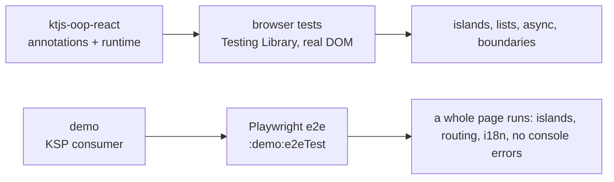

# Testing and troubleshooting

## Two test layers



The library's browser tests live in `ktjs-oop-react/src/jsTest`. They drive the real DOM through Testing
Library and assert against React's own scheduling — no sleeps, no coroutine test library.

**Annotation classes in tests hand-write `oopReactMeta(...)`.** KSP only reads a consumer's `jsMain`, so
the test source set builds its metadata by calling the runtime directly. That has a second effect: the
test file is the documentation of what the generator emits.

The demo has its own Playwright JUnit 5 suite under `demo/src/jvmTest`:

```bash
./gradlew :ktjs-oop-react:jsBrowserTest   # the library
./gradlew :demo:e2eTest                   # the reference consumer
./gradlew pagesSite                       # docs + demo + Dokka into build/pages
```

`e2eTest` is not part of `check` — it needs a browser, and `jvmTest` is disabled so `build` stays
offline-friendly. Assertions use Playwright's retrying `assertThat`, because state changes land a frame
after the click: `isVisible()` does not retry and turns a timing detail into a flaky failure.

## Failures that do not throw

The expensive ones are silent. Check in this order:

| Check | How |
| --- | --- |
| Is the instance observable? | a field that was never rendered is not observed yet; call `oopReactObservable(this)` if the object must be live before its first render |
| Is the field writable? | `var`, no `private set` |
| Did the generator run? | `initializeOopReact()` is in `main`, and the generated file is in the module's build output |
| Is the member name right? | `@JsName` on every annotated member; the processor fails the build when it is missing |
| Is the island even re-running? | add a render counter to the method and print it — the demo does exactly this |

## Failures that do throw

| Message | Meaning |
| --- | --- |
| `TypeError: yield* ... is not iterable` | a `suspend` function was annotated as an `@OopReactAction`; keep it out of MobX's action wrapper |
| `makeObservable` failure | an observable field has no setter |
| `ReferenceError` inside `js("...")` | a property was interpolated into the snippet; copy it into a local first |

## The demo as the reference consumer

`demo` applies the processor to its own sources, uses MUI for the UI, and renders the whole page from one
object graph (`App`). Its e2e suite covers exactly what a consumer worries about: island isolation, a
list that is a field, an async table, a broken render that must not take the page down, theme and
language switches, and a console with no errors.

Read `demo/src/jsMain/kotlin/demo/` next to [The model](the-model.md): every claim on that page has a page
or a method in the demo that shows it.
