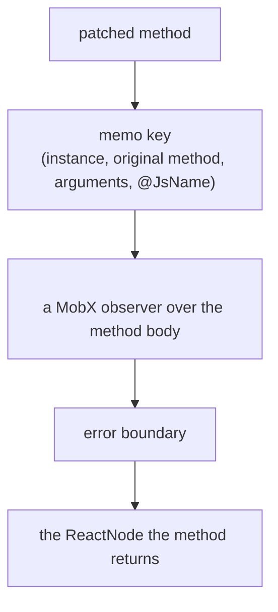

# The model

Four ideas, in the order they matter: a state class, an island, a list, and a key.

## State

`@OopReactState` makes an instance observable **lazily**: the class is observed the first time it is
rendered (or when you call `oopReactObservable(this)` yourself). That moment is chosen on purpose —
every object of the graph has been constructed by then, so inheritance and object cycles need no
constructor wrapping.

Observability then spreads along the graph: a field whose value is an instance of another registered
state class is made observable too, recursively. Library classes (`OopReactLoading`, `OopReactResource`,
`OopReactSelection`) call `oopReactObservable(this)` in their own `init` and do not depend on KSP.

## Islands

A `@OopReactRender` method is patched into three pieces:



What that buys, concretely:

- **Subscription per method.** The observer subscribes to the fields *that method* read. Nothing else in
  the class wakes it up.
- **Memoisation per island.** A parent island re-rendering does not re-run its children: the memo key
  makes each child its own element, so React sees the same node and skips it.
- **Its own error boundary.** A render method that throws shows a message where it sits; the rest of the
  page keeps rendering. The default fallback is a plain inline-styled `div`; the library depends on no
  UI toolkit.

```kotlin
@OopReactState
class Page(private val settings: Settings) {
    @OopReactRender          // reads only the route → page switches re-run this
    @JsName("content")
    fun content(): ReactNode = jsx { ... }

    @OopReactRender          // reads only the counter → a click re-runs this
    @JsName("counter")
    fun counter(): ReactNode = jsx { ... }
}
```

The demo prints how many times each island ran, so the isolation is visible rather than asserted.

## Actions

`@OopReactAction` wraps a method in a MobX action: every field written inside the call is applied as one
batch, and observers run once at the end. Use it for methods that change several fields — a plain
assignment is already observable, so single-field setters do not need it.

**Do not** annotate a `suspend` function. MobX's action wrapper sits between the suspend call and the
continuation machinery and the runtime fails with `TypeError: yield* ... is not iterable`. The async
helpers in the library therefore keep `loading` in a small separate state object and leave `run`
unobservable.

## Lists

`OopReactList()` is the observable `MutableList`. `add`, `remove`, `clear` and read access are tracked, so
a list is a field like any other:

```kotlin
val items: MutableList<Todo> = OopReactList()

@OopReactRender
@JsName("list")
fun list(): ReactNode {
    val current = items          // local copy: the DSL has its own names
    return jsx {
        Stack {
            for (item in current) {
                +row(item)
            }
        }
    }
}
```

A row that subscribes to its own item (`item.done`) re-runs alone when that flag flips.

## Keys

An island needs a React key that is stable per identity. Give `@OopReactRender` a property name:

```kotlin
@OopReactRender(key = "rowKey")   // reads the first argument, then the instance
@JsName("row")
fun row(item: Todo): ReactNode = ...

@JsName("rowKey")                 // the key producer carries @JsName too
fun rowKey(item: Todo): String = item.id.toString()
```

Read as a property, the processor looks for a field of that name, calls it if it is a method, and falls
back to `<instance id>.<method>` when there is no key. Without a key React can reuse the same fiber for
a different island — the symptom is one row's content appearing in another row after a removal.

## Traps that cost the most time

| Symptom | Cause |
| --- | --- |
| `ReferenceError: items is not defined` | `js("items[index]")` substitutes locals only; a property name compiles to a bare identifier. Copy it to a `val` first. |
| A wrong value in the UI | DSL name shadowing: `value` / `hidden` / `title` on an element beat your field. Use a local or `this@Class.field`. |
| Field changes but nothing repaints | the field is not observable: `private set`, a non-`var`, or an object that was never registered. |
| `makeObservable` throws | the field has no setter, or the class is annotated but the instance was never rendered. |
| Render method renamed away | missing `@JsName`. |
| Production-only breakage | class names are manglified to `iN`; island names come from the KSP-recorded source class name, which is why error reports read `FailurePage.broken`. |

Next: [Testing and troubleshooting](testing-and-troubleshooting.md).
