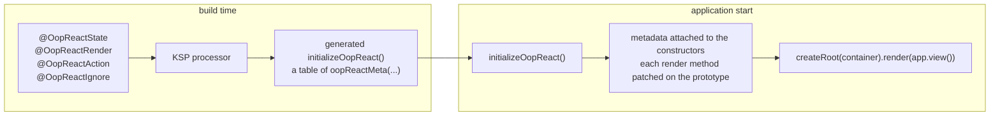

# Introduction

`ktjs-oop-react` brings the model of [oop-react](https://github.com/shijianjs/oop-react) to Kotlin/JS:

> **State and behaviour live in an ordinary class. Only the methods you annotate become React components.**

React itself is the official [kotlin-wrappers](https://github.com/JetBrains/kotlin-wrappers) binding, and
observability is MobX — not a layer written for this library.

```kotlin
@OopReactState
class Cart {
    val items: MutableList<Item> = OopReactList()

    fun add(item: Item) {
        items.add(item)
    }

    @OopReactRender
    @JsName("view")
    fun view(): ReactNode = jsx {
        ul {
            for (item in items) {
                li { +item.title }
            }
        }
    }
}
```

## The shape of the problem

A React component is a function of props and state, and the seams between them are what this model
removes. In TypeScript, oop-react could lean on decorators: one marked the class, one marked the
methods, and both ran **when the class was defined**.

Kotlin/JS has neither of those hooks:

| TypeScript had | Kotlin/JS has |
| --- | --- |
| decorators, executed at class definition | annotations, with no runtime reflection |
| `prototype` / constructor wrapping | a class whose members are renamed (`name_<hash>_k$`) |
| `this` bound by the decorator | an explicit `@JsName` so the runtime can find the member |

So the model is rebuilt in two halves, and this repository is those two halves plus their proof:



The one statement you have to write is `initializeOopReact()` at startup. Everything else is the code
you would have written anyway: classes, fields, methods.

## What is in the repository

| Module | What it is |
| --- | --- |
| `ktjs-oop-react` | The published library: annotations, runtime (prototype patching, render islands, error boundaries, configuration, async helpers, selections, lifecycle) and the MobX binding. |
| `ktjs-oop-react-ksp` | The KSP processor consumers apply to their own module. Build-time only — it publishes no Dokka. |
| `demo` | The reference consumer: applies KSP, uses MUI, renders a whole page from one object graph. Published under `/demo/`. |
| `docs` | This site. |

## What it does not do

- It is not a smaller API in place of hooks. There is no `use*` function in the library; the observable
  field **is** the state, so there is nothing for a hook to subscribe to.
- It does not add a rendering model of its own. React renders what the annotated methods return; the
  library only decides *when* those methods run.
- It does not hide MobX. A field that does not repaint is a field MobX does not consider observable —
  that is the first thing to check, and it is inspectable.

Next: [Getting started](guide/getting-started.md) wires the processor in, and [The model](guide/the-model.md)
explains what an island actually is.
