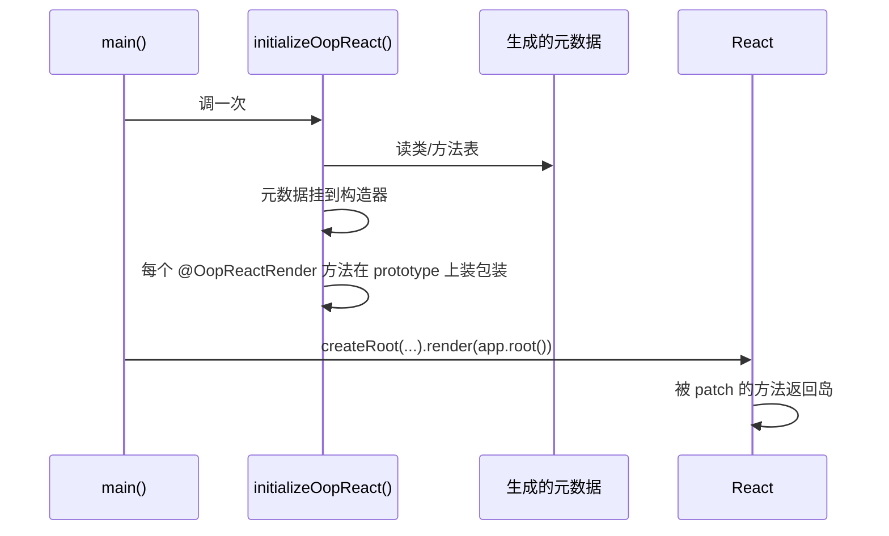

# 快速开始

一个消费方模块只需要四件事：库、KSP 处理器、启动时那次调用，以及每个注解成员上的 `@JsName`。

## 依赖

```kotlin
plugins {
    kotlin("multiplatform")
    id("com.google.devtools.ksp")
}

kotlin {
    js {
        useEsModules()
        browser()
    }
}

dependencies {
    implementation("io.github.shijianjs:ktjs-oop-react:<version>")
    add("kspJs", "io.github.shijianjs:ktjs-oop-react-ksp:<version>")
}
```

是 `kspJs` 而不是 `ksp`：处理器读的是 JS 编译的源码，生成的文件也写回同一个编译。本库是 Kotlin/JS 的
重实现，不是 npm 包的 wrapper，所以没有 npm 依赖参与。

## 四个注解

| 注解 | 标在哪里 | 含义 |
| --- | --- | --- |
| `@OopReactState` | 类 | 实例可观察，字段被追踪 |
| `@OopReactRender` | 返回 `ReactNode` 的成员函数 | 该方法变成一个 React 岛 |
| `@OopReactAction` | 成员函数 | 这次调用是 MobX action（其中的状态修改会合批） |
| `@OopReactIgnore` | 成员 | 显式排除，处理器不再报错 |

处理器每个模块只生成一个函数：

```kotlin
package io.github.shijianjs.ktjs.oopreact.generated

fun initializeOopReact() { /* 每个注解类一条 oopReactMeta(...) */ }
```

**在第一次渲染之前调一次**：

```kotlin
fun main() {
    initializeOopReact()
    createRoot(document.getElementById("root")!!).render(App().root())
}
```



少了这一行，注解类就是普通类：没有订阅、没有岛、没有错误边界 —— 而且**什么都不会抛**。

## `@JsName` 是必须的

Kotlin/JS 把成员 `view()` 编译成 `view_<hash>_k$`，哈希无法从源码推出。运行时要按 JavaScript 名字找到成
员，所以每个注解成员都要声明一个：

```kotlin
@OopReactRender
@JsName("view")
fun view(): ReactNode = ...
```

缺少它时处理器直接让构建失败，并告诉你该写什么。这是最常见的第一个错误。

## DSL

`jsx { }` 是渲染方法的主体：它是一个 React Fragment（DOM 上不额外加节点），里面可用 kotlin-wrappers 的
HTML DSL。

```kotlin
@OopReactRender
@JsName("card")
fun card(): ReactNode {
    val title = this.title      // 先取到局部变量，原因见下
    return jsx {
        div {
            h2 { +title }
            p { +"read $count times" }
        }
    }
}
```

那个局部变量不是风格问题：DSL 里裸名字会先命中**元素自身**的属性，`value`、`hidden`、`title` 之类会悄悄
变成 DOM 属性而不是你的字段。先把值取成局部变量，或者写 `this@Class.field`。

## 消费方的目录形状

```
src/jsMain/kotlin/<app>/
├── App.kt          // @OopReactState，对象图的根，一个岛一个 @OopReactRender
├── pages/          // 一页一个类，各自组装自己的岛
└── ...
src/jsMain/resources/index.html   // 只有一个 <div id="root">
```

本仓库的 demo 就是这个形状，可以对着这一页读。

接下来：[模型](the-model.md)。
