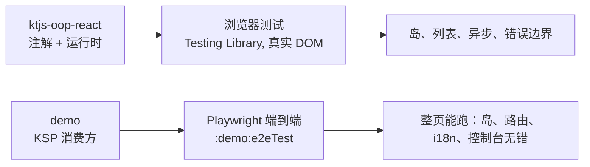

# 测试与排错

## 两层测试



库的浏览器测试在 `ktjs-oop-react/src/jsTest`，用 Testing Library 驱动真实 DOM，断言 React 自己的调度 ——
不 sleep、也不引协程测试库。

**测试里的注解类手写 `oopReactMeta(...)`**：KSP 只读消费方的 `jsMain`，所以测试源集直接调运行时构造元
数据。这还有个副作用：那份测试文件就是「生成代码长什么样」的文档。

demo 有自己的 Playwright JUnit 5 套件，在 `demo/src/jvmTest`：

```bash
./gradlew :ktjs-oop-react:jsBrowserTest   # 库
./gradlew :demo:e2eTest                   # 参考消费方
./gradlew pagesSite                       # 文档 + demo + Dokka 组装到 build/pages
```

`e2eTest` 不在 `check` 里 —— 它要浏览器，而 `jvmTest` 被禁用以保持 `build` 离线可用。断言一律用 Playwright
可重试的 `assertThat`：状态变化发生在点击后的一帧，`isVisible()` 不重试，会把时序细节变成偶发失败。

## 不抛异常的错误

最贵的恰恰是静默的。按这个顺序查：

| 检查 | 怎么查 |
| --- | --- |
| 实例可观察吗？ | 从未渲染过的实例还没被观察；对象要在首次渲染前就能用，就自己调 `oopReactObservable(this)` |
| 字段可写吗？ | 是 `var`，没有 `private set` |
| 生成代码跑过吗？ | `main` 里有 `initializeOopReact()`，生成的文件 在模块构建产物里 |
| 成员名字对吗？ | 每个注解成员都有 `@JsName`；缺了处理器会让构建失败 |
| 岛到底重跑了吗？ | 给方法加一个重跑计数并打印 —— demo 就是这么做的 |

## 会抛的错误

| 信息 | 含义 |
| --- | --- |
| `TypeError: yield* ... is not iterable` | 把 `suspend` 函数标成了 `@OopReactAction`；它不该进 MobX 的 action 包装 |
| `makeObservable` 失败 | 某个可观察字段没有 setter |
| `js("...")` 里 `ReferenceError` | 把属性名插进了片段；先取到局部变量 |

## demo 是参考消费方

`demo` 对自己的源码应用了处理器，UI 用 MUI，整页由一张对象图（`App`）渲染。它的 e2e 套件覆盖的正是消费方
担心的事：岛隔离、作为字段的列表、异步表格、不能拖垮整页的坏渲染、主题与语言切换，以及零错误的控制台。

对照 [模型](the-model.md) 读 `demo/src/jsMain/kotlin/demo/`：那一页上的每条说法，在 demo 里都有对应的一页
或一个方法。
