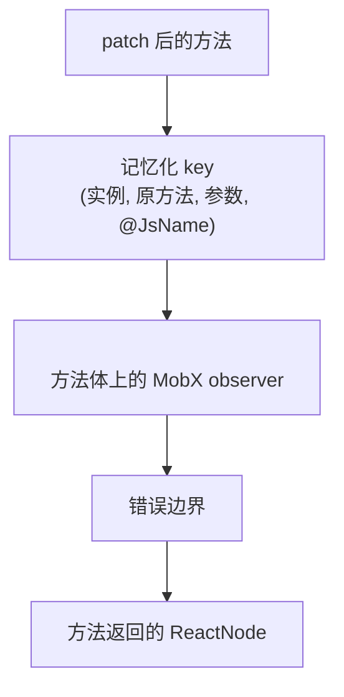

# 模型

四个概念，按重要程度排：状态类、岛、列表、key。

## 状态

`@OopReactState` 让实例**惰性**可观察：第一次被渲染时（或你自己调 `oopReactObservable(this)` 时）才
`makeObservable`。这个时机是有意的 —— 那时对象图上所有对象都构造完了，继承与循环引用因此都不需要包
构造器。

可观察性随后沿对象图扩散：字段值如果是另一个已注册状态类的实例，它也会被递归标注。库自带的类
（`OopReactLoading` / `OopReactResource` / `OopReactSelection`）在自己的 `init` 里调用
`oopReactObservable(this)`，不依赖 KSP。

## 岛

一个 `@OopReactRender` 方法会被 patch 成三件套：



具体换来什么：

- **一个方法一个订阅**。observer 只订阅**这个方法**读到的字段，类里别的字段唤醒不了它。
- **一个岛一份记忆化**。父岛重渲染不会带着子岛跑：记忆化 key 让每个子岛成为自己的元素，React 看到同一个
  节点就跳过。
- **自带错误边界**。抛异常的渲染方法就地显示一段信息，页面其余部分继续渲染。默认 fallback 是一个内联样式
  的朴素 `div` —— 库不依赖任何 UI 组件库。

```kotlin
@OopReactState
class Page(private val settings: Settings) {
    @OopReactRender          // 只读路由 → 换页只重跑它
    @JsName("content")
    fun content(): ReactNode = jsx { ... }

    @OopReactRender          // 只读计数器 → 点一下只重跑它
    @JsName("counter")
    fun counter(): ReactNode = jsx { ... }
}
```

演示页会把每个岛跑了几次印出来，所以「隔离」是看得见的，不是断言出来的。

## Action

`@OopReactAction` 把方法包成 MobX action：调用中写入的所有字段合成一批，observer 在结尾只跑一次。适合一次
改多个字段的方法 —— 单字段赋值本来就可观察，不需要它。

**不要**把 `suspend` 函数标上去。MobX 的 action 包装夹在 suspend 调用与续体机制之间，运行时会抛
`TypeError: yield* ... is not iterable`。所以库里的异步助手把 `loading` 放进一个独立的小状态对象，`run`
本身保持不可观察。

## 列表

`OopReactList()` 就是可观察的 `MutableList`。`add`、`remove`、`clear` 与读取都被追踪，列表因此是一个普通字段：

```kotlin
val items: MutableList<Todo> = OopReactList()

@OopReactRender
@JsName("list")
fun list(): ReactNode {
    val current = items          // 先取局部：DSL 有自己的同名属性
    return jsx {
        Stack {
            for (item in current) {
                +row(item)
            }
        }
    }
}
```

订阅自己那一项（`item.done`）的行，只在自己这一项变化时单独重跑。

## Key

岛需要一个按身份稳定的 React key。给 `@OopReactRender` 一个属性名即可：

```kotlin
@OopReactRender(key = "rowKey")   // 先看第一个参数，再看实例
@JsName("row")
fun row(item: Todo): ReactNode = ...

@JsName("rowKey")                 // key 生产者同样要 @JsName
fun rowKey(item: Todo): String = item.id.toString()
```

按属性读：处理器找同名字段，是方法就调用；没有 key 时回落到 `<实例 id>.<方法>`。没有 key 时 React 可能把
同一个 fiber 复用给另一个岛 —— 症状是删掉一行后，某行的内容出现在另一行里。

## 最花时间的坑

| 症状 | 原因 |
| --- | --- |
| `ReferenceError: items is not defined` | `js("items[index]")` 只替换局部变量，属性名会编译成裸标识符。先取到 `val`。 |
| UI 里出现了错的值 | DSL 名字被元素属性遮蔽：`value` / `hidden` / `title` 先命中元素。用局部变量或 `this@Class.field`。 |
| 字段变了但不重绘 | 字段不可观察：`private set`、不是 `var`、或对象从未注册。 |
| `makeObservable` 抛错 | 字段没有 setter，或类标了注解但实例从未被渲染。 |
| 渲染方法找不到 | 缺 `@JsName`。 |
| 只在生产构建出错 | 类名被压成 `iN`；岛名来自 KSP 记下的源码类名，所以错误报告里是 `FailurePage.broken`。 |

接下来：[测试与排错](testing-and-troubleshooting.md)。
