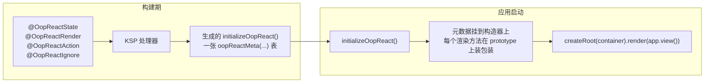

# 简介

`ktjs-oop-react` 把 [oop-react](https://github.com/shijianjs/oop-react) 的模型搬到 Kotlin/JS：

> **状态与行为待在一个普通类里，只有标了注解的方法才是 React 组件。**

React 本身用官方 [kotlin-wrappers](https://github.com/JetBrains/kotlin-wrappers) 绑定，可观察性就是
MobX —— 不是为本库另写的一层。

```kotlin
@OopReactState
class Cart {
    val items: MutableList<Item> = OopReactList()

    fun add(item: Item) {
        items.add(item)
    }

    @OopReactRender
    @JsName("view")
    fun view(): ReactNode = jsx {
        ul {
            for (item in items) {
                li { +item.title }
            }
        }
    }
}
```

## 要解决的问题

React 组件是 props 与 state 的函数，而这个模型要去掉的正是两者之间的接缝。在 TypeScript 里 oop-react
可以靠装饰器：一个标类、一个标方法，它们都在**类定义时**执行。

Kotlin/JS 这两样都没有：

| TypeScript 有 | Kotlin/JS 有 |
| --- | --- |
| 装饰器，在类定义时执行 | 注解，但没有运行时反射 |
| 改 `prototype` / 包构造器 | 成员被重命名（`name_<hash>_k$`） |
| 装饰器替你绑定 `this` | 必须显式写 `@JsName`，运行时才找得到成员 |

所以模型被拆成两半，本仓库就是这两半加上它们的证明：



需要你手写的只有启动时那一行 `initializeOopReact()`。其余都是本来就会写的代码：类、字段、方法。

## 仓库里有什么

| 模块 | 内容 |
| --- | --- |
| `ktjs-oop-react` | 发布的库：注解、运行时（patch prototype、渲染岛、错误边界、配置、异步助手、选择集、生命周期）与 MobX 绑定。 |
| `ktjs-oop-react-ksp` | 消费方自己模块里要应用的 KSP 处理器。只在构建期起作用，不发布 Dokka。 |
| `demo` | 参考消费者：应用 KSP、用 MUI、用一张对象图渲染整页。发布在 `/demo/`。 |
| `docs` | 本站。 |

## 它不是什么

- 它不是一个「更小的 hook API」。库里没有 `use*` 函数：可观察字段**就是**状态，hook 没有可订阅的东西。
- 它不自带渲染模型。React 渲染注解方法返回的节点，本库只决定这些方法**什么时候**运行。
- 它不隐藏 MobX。字段没重绘，通常就是 MobX 不认为它可观察 —— 这是第一个该查的地方，而且查得到。

接下来：[快速开始](guide/getting-started.md) 接线处理器，[模型](guide/the-model.md) 说明「岛」到底是什么。
